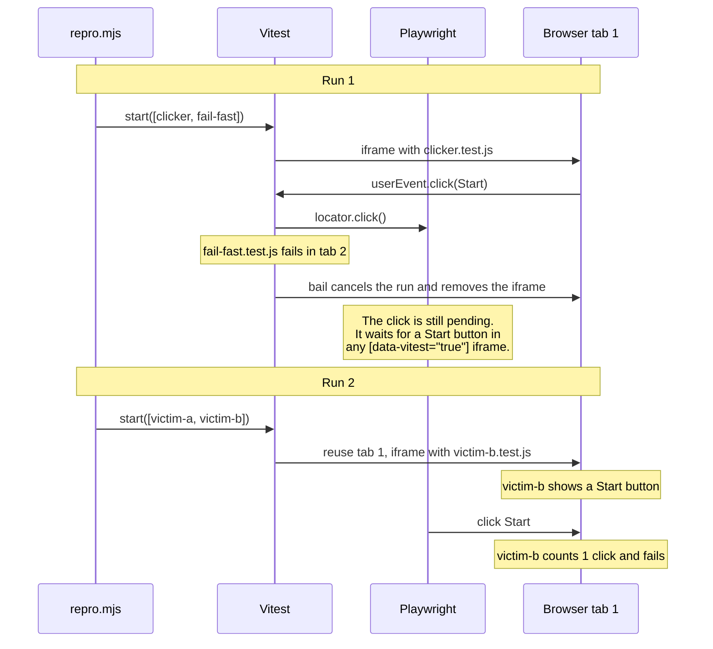

# A click from a cancelled Vitest run lands in the next run

In Vitest browser mode with the Playwright provider, a `userEvent.click()` can outlive the test that sent it. If `bail` cancels a run while a click waits for its element, Playwright keeps the click. When a test in the next run shows a matching button in the same browser tab, Playwright clicks it. That test then gets a click it never made.

You only see this when one Vitest instance runs tests more than once. [Stryker](https://stryker-mutator.io), a mutation testing tool, works that way. It keeps one Vitest instance per worker, sets `bail: 1`, and calls `vitest.start()` once for each mutant. In [nuqs](https://github.com/47ng/nuqs), a test counted one URL update too many because of this, and Stryker reported a surviving mutant as killed.

## Run it

```sh
pnpm install
pnpm exec playwright install chromium
pnpm repro
```

A failing run prints:

```
Run 1: fail-fast fails and bail cancels clicker while it clicks
  test/clicker.test.js: skip
  test/fail-fast.test.js: fail fail to trigger bail
Run 2: no test in this run clicks anything
  test/victim-a.test.js: pass
  test/victim-b.test.js: fail expected 1 to be +0 // Object.is equality
```

`BAIL=0 pnpm repro` passes, because nothing cancels a test in the middle of a click.

Out of 10 runs on each setup:

| Setup | Runs with a stray click |
| --- | --- |
| Vitest 4.1.11, `bail: 1` | 9 |
| Vitest 4.1.11, `bail: 0` | 0 |
| Vitest 5.0.4, `bail: 1` | 10 |
| Vitest 5.0.4, `bail: 0` | 0 |
| Vitest 4.1.11, `bail: 1`, Linux arm64 in Docker | 10 |
| Vitest 4.1.11, `bail: 1`, with the fix below | 0 |

## What the repro does

`repro.mjs` does what Stryker does, without Stryker. It creates one Vitest instance and starts it two times:

```js
const vitest = await createVitest('test', { watch: false, bail: 1 })

await run(['test/clicker.test.js', 'test/fail-fast.test.js'])
await run(['test/victim-a.test.js', 'test/victim-b.test.js'])
```

In run 1, `clicker.test.js` shows a Start button and clicks it again and again for 3 seconds:

```js
while (performance.now() < end) {
  await userEvent.click(page.getByRole('button', { name: 'Start' }))
}
```

At the same time, `fail-fast.test.js` throws after 1 second, and `bail` cancels the run.

In run 2, each victim test shows its own Start button for 2 seconds. Nothing in run 2 clicks, so both victims expect 0 clicks.

## What happens

Vitest runs each test file in an iframe with the attribute `data-vitest="true"`, inside a browser tab. Run 1 has two files that run at the same time, so Vitest opens two tabs.



The victim that runs in tab 1 gets the click. That can be `victim-a` or `victim-b`.

## Why the click moves to another test

Two parts of Vitest work together here.

First, the Playwright provider builds every locator from the tab, not from the iframe of the test that sent the command:

```js
// @vitest/browser-playwright 4.1.11, dist/index.js
get iframe() {
  return page.frameLocator('[data-vitest="true"]')
}
```

A Playwright locator is a query, not an element. Playwright runs the query again on each attempt, until it finds a match or the action times out. When `bail` removes the clicker's iframe, the query matches nothing, and Playwright keeps waiting. In this repro, the click waits until the tab closes. When the next run adds a new iframe with the same attribute, the query matches again.

Second, Vitest reuses tabs between runs. A tab that finished its files goes back to a pool of ready sessions, and the next `start()` gives it new files. See [pools/browser.ts](https://github.com/vitest-dev/vitest/blob/f15bdac4f05d2838855d4bd4f47e4076036ea18b/packages/vitest/src/node/pools/browser.ts#L467-L471).

Cancelling a test stops the test code. It does not stop the Playwright call that the test already made.

## A fix

Get the frame when the command starts, and fail if it is gone:

```js
get iframe() {
  const frame = page.frame('vitest-iframe')
  if (!frame) {
    throw new Error('Cannot find "vitest-iframe" on the page. The test that sent this command has ended.')
  }
  return frame
}
```

Vitest creates a new iframe element for each test file, in [orchestrator.ts](https://github.com/vitest-dev/vitest/blob/f15bdac4f05d2838855d4bd4f47e4076036ea18b/packages/browser/src/client/orchestrator.ts#L422-L428). So the old frame detaches, and the pending click fails instead of moving on.

Do not fall back to `page.frameLocator(...)` when the frame is missing. A command that arrives after one iframe goes away and before the next one appears would then reach the next test again.

`keyboard` and `dragAndDrop` use `context.frame()`, which waits for the next `frameattached` event. They probably have the same problem, but I did not test them.

## Tested with

- Vitest and `@vitest/browser-playwright` 4.1.11 and 5.0.4
- Playwright 1.61.1, Chromium headless shell
- macOS on Apple Silicon, and Linux arm64 in Docker with 4 CPUs
- The programmatic API only, not watch mode
